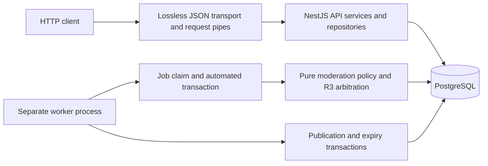

# Architecture

## Runtime processes

Docker Compose runs PostgreSQL, a NestJS HTTP API, and a separate NestJS worker.
Both Node processes use the same `pg` database module and bootstrap sequence.
The API factory completes database startup before the executable calls `listen`;
the worker sends `worker-started` only after its database-backed Nest context is
created. A bootstrap error exits startup and closes the pool.

## Database bootstrap

`src/db/assets.ts` validates the repository seed files and loads an explicit SQL
migration manifest. `src/db/database.ts` owns a PostgreSQL pool. On startup it
uses one checked-out client for a transaction-scoped advisory lock, the migration
ledger, any pending migration, and seed upserts. The lock serializes API/worker
startup on a new database. Migration checksums detect edits to an applied SQL
file; an unknown or non-prefix migration history stops startup without resetting
the database.

Connections, including PostgreSQL authentication/handshake, have a five-second
timeout. The separate five-second `lock_timeout` limits bootstrap lock waits;
neither setting is a total deadline for running migrations or seed SQL.

## Submission and reads

The versioned SQL in `migrations/` creates the reference, listing, idempotency,
job, and moderation-history tables and their persistence constraints. The API's
`POST /v1/listings` validates through the shared lossless JSON transport, then
uses the submission service and PostgreSQL repository to atomically persist a
pending listing, one queued moderation job, and an optional idempotency key.
The repository resolves concurrent key races only after the losing transaction
rolls back; a replay returns the persisted listing's current status. Submission
does not evaluate moderation rules or create a decision/history record. Single
listing and list queries share the `SubmissionModule` database registration. The read
repository selects `price_vnd::text` and `decision::text`; one mapper validates
the persisted state, parses decision JSON losslessly, and projects only public
DTO fields before the shared JSON response interceptor serializes it. List SQL
uses parameterized exact filters and `created_at DESC, id DESC`; `created_at`
ordering retains PostgreSQL timestamp precision even though public ISO strings
are formatted to milliseconds. Malformed known query encodings return 400 while
malformed unknown extension values are ignored.

## Automated processing

Moderation uses a pure R1/R2/R4/R5
evaluator and a read-only repository for persisted seller, category, and banned
keyword snapshots. Normal non-trusted listings require an explicit R3 fact;
R3 arbitration is performed by the transaction-bound automated listing
repository. The database-backed worker described below invokes that production
evaluation path.

The worker claims due jobs with PostgreSQL row locks and `SKIP LOCKED`, records a
UUID claim token and a 30-second database-clock lease, and processes one job at a
time per process. Claims include crash/lease recoveries and are capped at five;
retry scheduling uses full jitter with an exponential ceiling capped at 30 seconds.
An automated listing decision, append-only `auto` history row, and guarded job
completion commit in one transaction. The repository reuses the pure evaluator and
R3 arbitration against the caller's transaction; production listing mapping
validates the persisted decision before history is written. Failed attempts retain
the listing as pending, store only a sanitized diagnostic, and become `failed`
after exhaustion. Malformed live running metadata and live jobs pointing to a
non-pending listing are marked failed for operator inspection without changing
the listing or its history.
An operator may requeue a failed job only after inspection and confirming its
listing remains pending with no phase history; the guarded SQL template is
`ops/requeue-failed-job.sql` and the procedure is in README.md.
During shutdown the worker stops new claims and polling, waits for its active operation,
then closes the database pool. A forced process death leaves the lease for later
recovery.
The polling interval defaults to 1,000 milliseconds and is bounded to the Node
timer range of 1 through 2,147,483,647 milliseconds at both configuration and
worker-loop construction boundaries.

## Duplicate arbitration and rule precedence

R1 runs first for every seller and returns rejection reasons containing the
original matched seed terms. If R1 is clear, trust >=80 returns R4 approval
without R2/R3/R5. Other listings evaluate R2 with bigint multiplication
(`price > 3 * median` or `3 * price < median`) and R5, then incorporate R3.
Normal reasons are ordered R2, R3, R5; rejection takes precedence over escalation.
An ordinary approval can have an empty reason array.

The automated primitive requires the caller's explicit READ COMMITTED
transaction. After locking the candidate listing, it loads persisted references
on that client. For nonterminal policy paths it takes a transaction advisory lock
derived from the five-field normalized identity. Equal identities use the same
lock, so a competing automated transaction waits until its predecessor commits
or rolls back. The subsequent duplicate SELECT gets a fresh READ COMMITTED
snapshot and can see the predecessor's committed approval.

Identity consists of exact seller/category IDs and bigint price plus normalized
title and description: NFC, locale-independent lowercase, then NFC again.
Collapse Unicode `White_Space` to U+0020, then remove only U+0020 at both ends.
Preserve U+200B and U+FEFF. Stored content is unchanged. A versioned SHA-256
fingerprint is persisted, and a separately namespaced hash supplies a signed
64-bit advisory key. Hash collisions in the lock key can serialize unrelated
work but do not establish equality. Lookup filters active `auto_approved` and
`published` rows by seller/category/price, pages by `id COLLATE "C"` in batches
of 100, and compares normalized raw fields. A matching fingerprint is never
sufficient evidence; NULL or stale fingerprints do not exclude rows from comparison.

This serializes participating non-trusted automated approvals. Trusted approvals
and later human approvals deliberately bypass duplicate exclusion. Publication
keeps a row active; expiry may remove it from a later lookup. No global unique
constraint forbids these valid transitions. The existing seller/fingerprint
index does not turn this raw-field scan into an exact indexed identity lookup;
total work can grow with the active candidate set. Large scans can exceed the
lease duration. Indexing, backfill and lease renewal are candidates for tuning
after measuring a representative workload.

## Human decisions and publication

`POST /v1/listings/{id}/decision` is registered through the production human
module and HTTP transport. Its pipe validates and projects the request before the service
calls `HumanDecisionRepository`. The repository locks the listing in a
READ COMMITTED transaction and accepts only `needs_human` with a mapped
`escalated` decision and NULL publication timestamps. It writes the replacement
HUMAN decision, a database timestamp in `decided_at`, and one human history row in the same
transaction. Approval also sets `published_at` to that same instant and derives
`expires_at` using exact 24-hour days; rejection leaves both publication times
NULL. Conflicting requests see the committed terminal state and return 409.
Moderator metadata is retained in internal history, not exposed in the public
decision.

The worker runs `PublicationRepository` after its moderation work, scanning at
most one persisted `auto_approved` row per tick. It uses row locking with
`SKIP LOCKED`, validates the stored approval through the production mapper,
then updates status/timestamps/version transactionally. This lifecycle update
does not write another moderation history row or alter the automated decision,
`decided_at`, or job. A committed row remains discoverable after worker restart.
Publication SQL errors are logged separately from moderation failures and the
row remains eligible for a later scan. A permanently failing oldest row can
starve later rows; an operator must resolve the underlying data/SQL problem.
There is no publication quarantine or fairness scheduler in this design.
After publication the same worker loop runs a bounded expiry batch using the
PostgreSQL transaction clock. It changes only due `published` rows to `expired`
and increments their lifecycle version. A partial deadline index covers
published rows; expired rows retain the current decision, decided_at and audit
history. Restarted workers continue scanning persisted overdue rows.

## Health and diagnostics

The API health module owns both `/livez` and `/readyz`. Liveness reports only
that the listener can answer. Readiness uses the same bootstrapped `Database`
instance as listing routes and a bounded `SELECT 1`; it coalesces simultaneous
in-flight probes without caching a previous success. A failed probe returns a
public 503 without database details. A successful bootstrap is remembered for
this process; the probe does not rescan migrations or seeds on each request, so
it cannot detect every later schema or seed mutation. Shutdown marks readiness
draining before the pool closes. The probe releases checked-out clients and
destroys one after query error or timeout; the driver's client-side timeout is
not a claim that PostgreSQL cancelled a server-side operation.

Worker completion metadata comes from the mapped persisted decision inside
the automated commit transaction and is logged only after commit. Claim recovery,
quarantine, exhaustion and stale results use allowlisted identifiers and safe
diagnostics. The read-only operator SQL and guarded requeue template live under
`ops/` and are executed manually by an operator.

## Transactions and resource ownership

`src/db/transaction.ts` checks out one `PoolClient` and uses it for `BEGIN`, all
callback statements, and `COMMIT` or `ROLLBACK`. The callback must not issue
transactional work through `Pool.query`. Each `Database` owns its pool and closes
it through the Nest shutdown lifecycle. Tests create uniquely named databases
inside the isolated Compose PostgreSQL service and drop them only after their
application pools are closed.

The helper returns a callback result only when PostgreSQL reports the `COMMIT`
command. A callback that catches a SQL error may leave an aborted transaction;
if PostgreSQL ends it with `ROLLBACK`, the helper rejects and discards that
checked-out client. Callback work is never automatically retried after a commit
failure with an uncertain outcome.

The automated commit path locks listing, then job, then its R3 advisory key.
Human decisions lock only the listing; operator requeue follows listing-before-job
order. Claim selection locks a job in a separate short transaction and releases
it before evaluation. Token and DB-time lease checks occur after the row locks
and again in the completion UPDATE. Losing that final guard throws, rolling back
the listing change and history together. An expired or replaced attempt cannot
overwrite a later committed result. The unique `(listing_id, phase)` constraint
also prevents a second history record; a trigger rejects history UPDATE, DELETE
and TRUNCATE through ordinary application access.

Submission idempotency is enforced by the unique key inside the transaction,
even though an initial read can fast-path a replay. Canonical hashing includes
unknown JSON properties, exact strings and exact mathematical numeric values;
object key order is irrelevant. The API key is optional, case-sensitive and
global, with no cleanup policy. Reusing a key with a different canonical body
conflicts. A network loss after COMMIT can hide a successful response; retrying
with the same submission key recovers its identity. Human requests have no
separate replay key: after a committed resolution a repeated decision gets 409
and the caller can GET the current result.

Price parsing retains the JSON numeric token, checks nonnegative int64 syntax
and bounds, then creates bigint. PostgreSQL binding uses decimal strings and
BIGINT; reads select price/decision as text to avoid driver rounding. The mapper
creates bigint/lossless values and the response interceptor emits numeric JSON
tokens. Ordinary JSON.parse at the client can still round them. Request
validation, persisted-state mapping and response serialization are distinct
boundaries; malformed stored data fails closed rather than producing a partial
or silently repaired public result.

The submission pipe validates text before database access: title and description
reject U+0000 and unpaired UTF-16 surrogates with 400; reference IDs containing
those values return 422. Valid Unicode scalar text is stored unchanged. Unknown
JSON properties participate in the idempotency hash but are not persisted as
listing fields.

## Runtime assets

The final API/worker image contains compiled JavaScript plus `seed/` and
`migrations/`. Asset lookup is rooted at the compiled application location, not
the process working directory. The test image also contains these files and
uses the real PostgreSQL service for integration tests.

The test runner discovers source `.test.mjs` and compiled `.test.js` files after
cleaning `dist`. HTTP integration tests use actual production registrations and
TCP responses; worker process tests run compiled executables against PostgreSQL.
Fault-injection tests use client wrappers or database triggers to exercise
specific rollback paths. Database barriers make selected concurrency
interleavings reproducible. Lifecycle shell smoke checks run separately from
`make test`.

## Deployment scope and production priorities

The supported local topology is one PostgreSQL database with separate API and
worker processes. Multiple workers coordinate through database locks and leases;
there is no process-local correctness lock. Polling processes one moderation
claim per worker tick, then one publication and at most 100 expirations, so the
interval also limits throughput. Readiness checks this API's database access,
not worker progress or queue age. Per-statement 10-second statement and 5-second
lock limits are not a total transaction deadline; there is no lease heartbeat.

Named volumes survive normal process/container restarts. Explicit volume deletion,
host loss or corruption is outside that durability scope. The service has no
replica failover, backup/restore automation, idempotency retention, or audit
retention policy. Seed-file rows are restored on each bootstrap, so changing
those rows directly in the database is not a durable reference-data workflow.

Before an external deployment, add authenticated and authorized moderator access,
managed credentials/TLS and network policy, and tested database backups/restores.
Then monitor queue age, exhaustion, publication backlog, expiry lag and lease
loss; define throughput/recovery targets before tuning workers, indexes or leases.
A persistently failing publication row requires operator repair and can starve later
rows; add a separately specified retry/quarantine policy if unattended operation
requires fairness. Review dependency advisories and patch the development YAML
parser before accepting untrusted YAML in repository tooling. Pin deployment
image digests and rehearse the final committed artifact in its target environment.
These capabilities are outside the current implementation scope.
